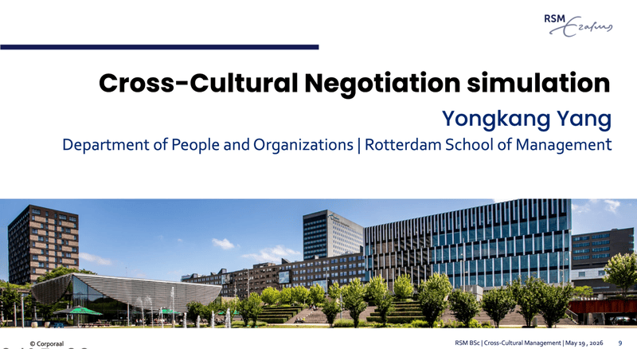
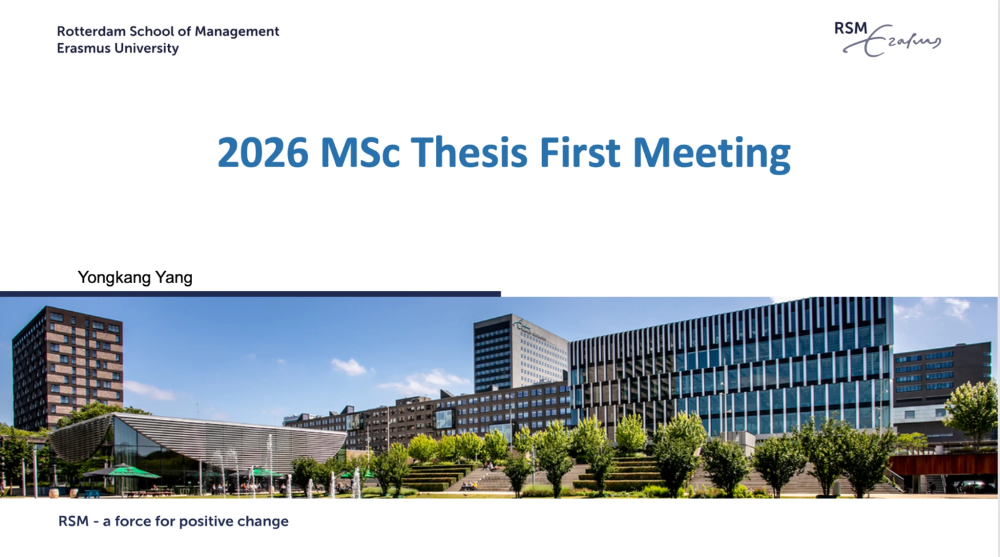
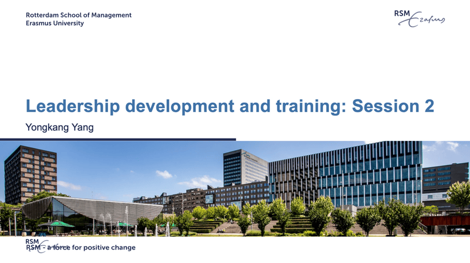
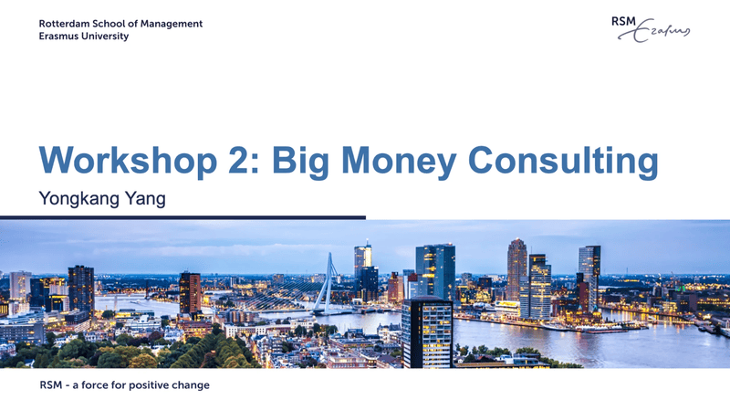
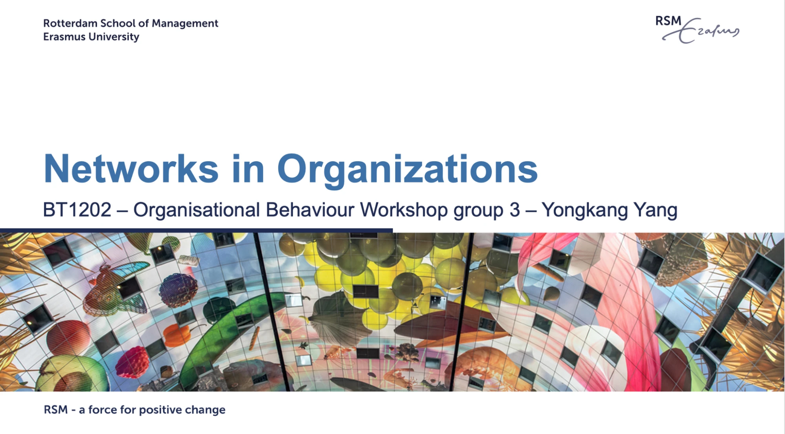

I teach and supervise in organizational behavior and human resource management at Rotterdam School of Management, Erasmus University Rotterdam.

  
  

    
<strong>2026, Cross-Cultural Management Workshop</strong>

    
Cross-cultural negotiation simulation workshop.

  

  
  

    
<strong>2026, Master Thesis Supervision</strong>

    
Supervising 4 MSc thesis students.

  

  
  

    
<strong>Fall 2025, Leadership Development and Training</strong>

    
Master level; teaching evaluation: 4.4/5.

  

  
  

    
<strong>2025, Human Resource Management Workshop</strong>

  

  
  

    
<strong>2025, Organizational Behavior Workshop</strong>

  

  
  

    
<strong>Fall 2024, Organizational Behavior Workshop</strong>

    
I organized 30 workshops for over 1500 students.

  

  
  

    
<strong>Spring 2023, Master Thesis Supervision</strong>

    
Supervised 3 master theses.

  

  
  

    
<strong>Spring 2023, Bachelor Thesis Supervision</strong>

    
Supervised 7 bachelor thesis teams with 28 students.

  

  <video src="https://pub-0ca7268f5327450bb58d14ef32e91b39.r2.dev/homepage/company-project-video.mp4" muted playsinline preload="metadata" onmouseover="this.play()" onmouseout="this.pause(); this.currentTime = 0;"></video>
  

    
<strong>Fall 2022, Professional Development and Consulting</strong>

    
As an academic coach, I supervised 4 master student teams who worked as consultants to solve real-world human resource challenges for major companies.

    
Master level; teaching evaluation: 4.0/5.

    
<a href="https://www.linkedin.com/posts/rotterdam-school-of-management-erasmus-university_how-did-it-go-for-the-msc-human-resource-activity-7041724795322818560-xd3Q">Check this out: A LinkedIn post from RSM.</a>

  

